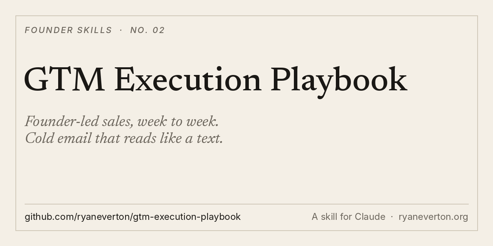

<p align="center"></p>

# GTM Execution Playbook

**Founder-led sales, week to week. Cold email that reads like a text, the flooded vs. untouched test, lead magnets and AEO.**

A skill for Claude and other agents. Give it your business. Get back the verdict on your buyer, the email, the in-person motion, the lead magnet, 10 AEO questions, and a 30-day plan with numbers to hit by Friday.

[Install](#install) · [What it makes](#what-it-makes) · [Use it](#use-it) · [Why I built it](#why-i-built-it)

## What it makes

- **The verdict.** Is your buyer flooded (everyone is already emailing them) or untouched? Every channel choice follows from it.
- **Stage check.** Who should be selling right now. Before $10M ARR, it's you.
- **The email.** Two sentences, in your voice, no links, no dashes. Plus the list and the trigger.
- **The in-person motion** for the next 30 days. Co-host, don't sponsor.
- **The lead magnet** and the comment-for-copy post, drafted.
- **10 AEO questions** your buyer's agent will ask, and how to become the cited answer.
- **A 30-day plan** with weekly reply-rate and meeting targets.

## Install

**Claude Code**

```
/plugin marketplace add ryaneverton/gtm-execution-playbook
/plugin install gtm-execution-playbook@gtm-execution-playbook
```

**Any agent (Cursor, Codex, Gemini CLI and more)**

```
npx skills add ryaneverton/gtm-execution-playbook
```

**Claude app (web and desktop)**

1. Download [gtm-execution-playbook.zip](https://github.com/ryaneverton/gtm-execution-playbook/raw/main/dist/gtm-execution-playbook.zip)
2. In Claude, open **Customize › Skills**, click **+**, then **Create skill › Upload a skill**
3. Upload the ZIP

**Manual**

```
git clone https://github.com/ryaneverton/gtm-execution-playbook
cp -r gtm-execution-playbook/skills/gtm-execution-playbook ~/.claude/skills/
```

## Use it

- "Write our outbound plan. We sell [X] to [ICP]."
- "Our cold email gets 1% replies. Fix it."
- "Build a lead magnet plan for [business]."
- "What are the 10 questions buyers ask ChatGPT that we should own?"

## Why I built it

Most go-to-market advice is theory. I wanted rules: who to email, what to write, when to stop emailing and get in a room. This is distilled from a founder-summit GTM session with operators who have taken B2B companies from zero to scale, then hardened into checks Claude enforces on every draft.

The test that matters most: is your buyer flooded or untouched? Builders, trades and regional owners still answer a two-sentence email. VCs and startups don't. Know which one you're selling to before you write a word.

## Pairs with

- [leverage-playbook](https://github.com/ryaneverton/leverage-playbook): who makes the business big
- [pilot-to-scale-gtm](https://github.com/ryaneverton/pilot-to-scale-gtm): turn pilots into contracts, and contracts into expansion
- [founder-daily-operator](https://github.com/ryaneverton/founder-daily-operator): run several companies with agents, safely

## About

Built by [Ryan Everton](https://ryaneverton.org). I write [The Intuitive Founder](https://ryaneverton.substack.com), on pragmatic AI and the inner work of building something real.

If this helped, star the repo and tell me what you sold with it: [@ryandeverton](https://x.com/ryandeverton).

MIT License.
